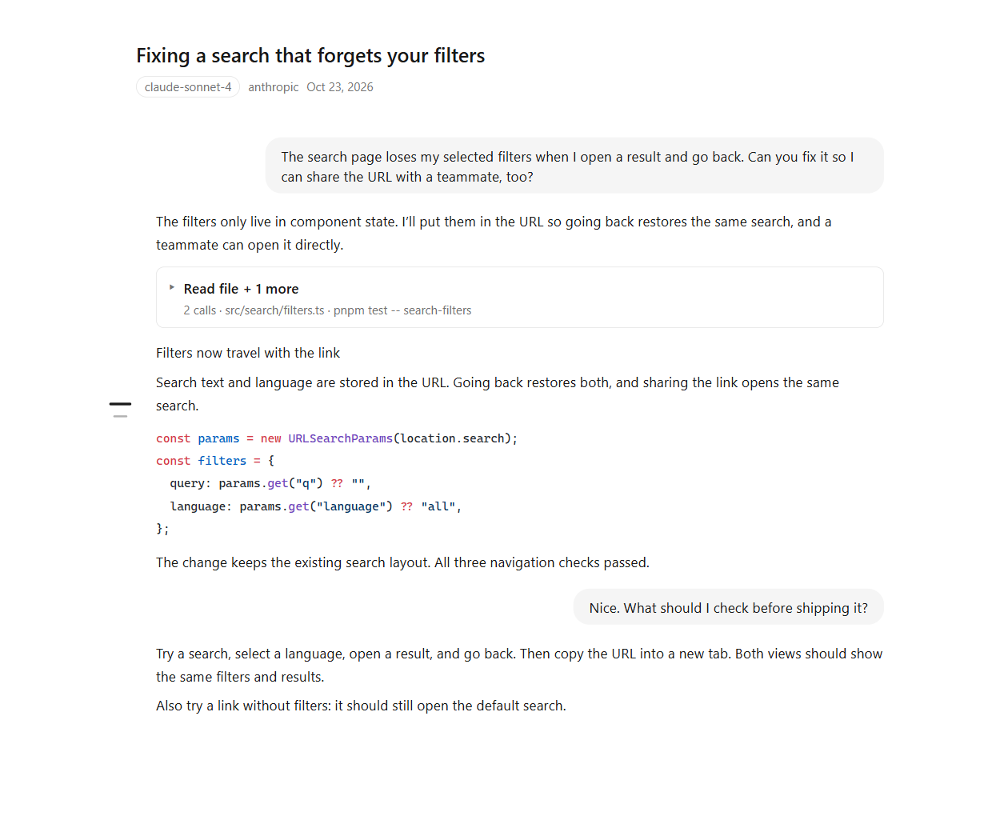
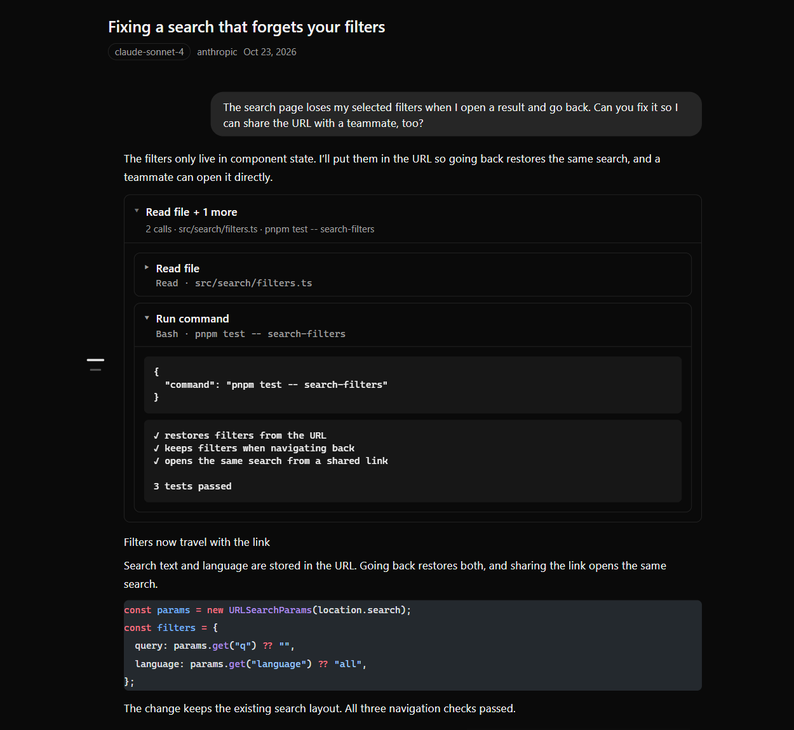

# Quire

Share your AI coding conversations as readable links.

Show a teammate how you found a bug, pass along an implementation walkthrough,
or share a useful conversation without asking someone to read your terminal history.
Quire turns sessions from **Claude Code, Codex, ZCode, and Oh My Pi** into
read-only pages that anyone with the link can open in a browser.

[Set up Quire](docs/technical/setup.md) · [CLI and integrations](docs/technical/cli.md) · [Technical documentation](docs/technical/README.md)

## Keep the conversation readable

Recipients see the conversation in order, with formatted Markdown and
syntax-highlighted code. Tool activity stays compact until they want the details,
so they can follow the answer first and inspect the work behind it afterward.
Long sessions load as they scroll, and the viewer follows their system's light
or dark appearance.

*Screenshots use a synthetic example conversation, not a private session.*

## Choose what you share

- Publish when you decide to share. Installing Quire does not upload your conversations.
- Add a password or an expiration date when a link should have limited access.
- List your shares, change an expiration date, or revoke a link when you no longer need it.
- Automatically redact recognized secrets before conversation content is stored.
  Review sensitive material before publishing; automated redaction cannot catch everything.

Quire is self-hosted: you or your team run the server and choose where shared
conversations live. Recipients only need a browser, the complete link, and a
password if you set one. Your server processes the conversation during publishing;
read the [security guide](docs/technical/architecture-security.md) if you plan to
share sensitive work.

## Start sharing

1. [Set up your Quire server and publisher CLI](docs/technical/setup.md).
2. Connect your coding tool. Claude Code and ZCode use `/share`, Codex uses
   `$share`, and Oh My Pi uses `/share` after installing its Quire handler.
   You can also publish with the CLI.
3. Send the resulting link. Your recipient can read the conversation and expand
   code and tool details without installing Quire.

The [CLI and integration guide](docs/technical/cli.md) covers per-tool setup,
passwords, expiration, and managing published shares. In-tool share commands
publish immediately; the CLI normally asks for confirmation.

For deployment, architecture, security, development, and testing, see the
[technical documentation](docs/technical/README.md).
